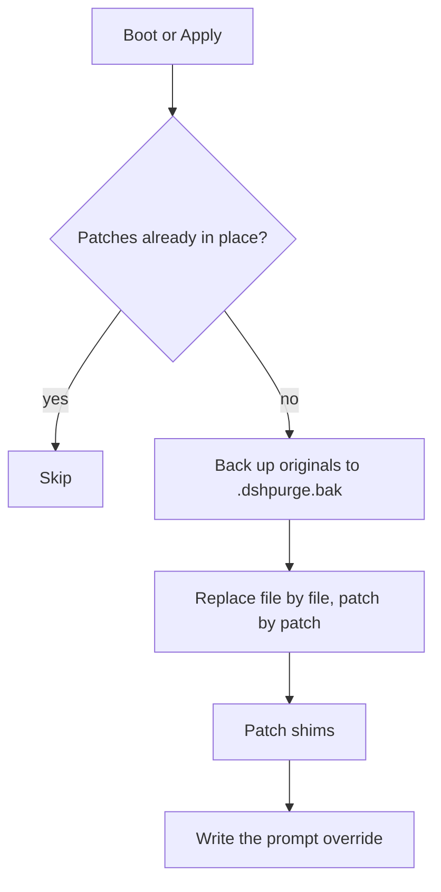

<p align="center">
  
</p>

<h1 align="center">dsh-purge</h1>

<p align="center"><strong>A local plugin that takes the DeepSeek Harness host's instruction authority apart — and puts back only what you choose.</strong></p>

<p align="center">
  <a href="LICENSE"></a>
  
  
  
</p>

<p align="center">
  <a href="README.md"><strong>中文</strong></a> · <strong>English</strong> · <a href="docs/ROADMAP.md">Roadmap</a>
</p>

> **What this is.** A plugin for the official [DeepSeek Harness](https://www.deepseek.com/harness/) you already have installed. It enumerates every layer the host wraps around your conversation at runtime — system prompt, approval gates, sandbox policy, tool receipts, session rewrites — and lets you change, skip or revert each one **on your own install**. 86 patches, all reversible.
>
> **What this repo is.** `Water-Run/dsh-purge`, a personal derivative of [YuJunZhiXue/dsh-purge](https://github.com/YuJunZhiXue/dsh-purge), single branch `master`. **The upstream license and attribution rules are inherited unchanged** — see [License & attribution](#license--attribution).
>
> **This repo ships nothing.** No releases, no zip, no tgz, no npm package, no install support channel. If you want it, point your agent at this repo and let it follow the [install contract](#agent-install-contract). See [No builds here](#no-builds-here).

---

## Contents

- [What it touches](#what-it-touches)
- [Compatibility](#compatibility)
- [No builds here](#no-builds-here)
- [Install](#install)
- [Agent install contract](#agent-install-contract)
- [Usage](#usage)
- [Unlock switch](#unlock-switch)
- [How it works](#how-it-works)
- [Troubleshooting](#troubleshooting)
- [Tracking upstream](#tracking-upstream)
- [Fork delta](#fork-delta)
- [Roadmap](#roadmap)
- [License & attribution](#license--attribution)
- [Scope](#scope)

---

## What it touches

Harness does not simply hand your prompt to the model. It edits things at runtime, layer by layer. Judging only "did the model answer" mistakes host interception for model refusal. This plugin exists to separate those two layers and keep the second one controllable.

| Layer | Examples (patch ids) | What changes |
| --- | --- | --- |
| **Prompt** | identity prefix, workspace section, approval wording, minimal/PTC preset blocks (#1–#5, #25, #26, #53, #54, #61, #63, #70, #73, #76) | The system prompt no longer carries host-injected identity and prohibition lines |
| **Code** | approval defaults, sandbox verdicts, file fences, escalation grants, tool caps, subagent depth (#6–#24, #35, #51, #52, #92) | Local default policy follows your choice instead of re-asking every turn |
| **Tools** | shell / network / delete-move refusal text and schema (#29–#33, #48, #60, #64, #65) | Tool receipts stop carrying lectures |
| **Compat** | 0.1.5 / 0.2.0 / 0.2.1 wiring (#40, #42, #47, #49, #57, #90, #91) | Patches still hit after a host upgrade instead of all going `pending` |
| **shim / runtime** | `dsh.cmd` / `dsh.ps1` injection, Windows command flash, apply markers (#78, #82, #85–#89) | Every launcher entry point carries the same config after an upgrade wipes `node_modules` |

Two side-panel pages: **Clean** (patches, prompt, rule sets, skills, own servers) and **Drill** (assets, skills, environment — after authorization). Every target file is backed up to `<name>.dshpurge.bak` before it is touched. Re-applying is idempotent; reverting restores the original byte for byte.

---

## Compatibility

| Host | Status | Which build |
| --- | --- | --- |
| Official `dsh web`, dsh **0.2.0-rc.2 / 0.2.1-rc.2** | ✅ this repo's `master` | commands below |
| Official desktop EXE, dsh **0.2.0-rc.2 / 0.2.1-rc.2** | ✅ profile `desktop` | commands below |
| dsh **0.1.7** | ⚠️ upstream 1.1.39 or earlier | [upstream releases](https://github.com/YuJunZhiXue/dsh-purge/releases) |
| Community desktop builds | ❌ unmaintained | — |

Web and desktop are **two separate profiles** (`web`, `desktop`). Install and apply each one on its own. Patches that no longer match report `pending` / `skipped` and are left alone; the apply still completes.

`node >= 18`. There is no `dsh-purge` package on npm — `pnpm add dsh-purge` always 404s.

---

## No builds here

This repo **tracks upstream and publishes nothing**:

- ❌ no GitHub Releases, zip or tgz — `.github/workflows/release.yml` is gone; pushing code produces no artifacts
- ❌ no npm package — `pnpm add dsh-purge` always 404s
- ❌ no prebuilt tarball, mirror link or channel drop
- ❌ no install support, customization or business inquiries

The only source is the `master` branch itself. So let an agent do it:

```text
I want to use this repo on this machine. Read the AGENT-INSTALL contract in README.md
and install dsh-purge into the local DeepSeek Harness profiles web and desktop.
Install only — do not apply patches, do not restart. Then report in the contract's format.
```

That works for MiniMax Code, Claude Code, Codex and Cursor alike; only the paste target differs — see [Agent install contract](#agent-install-contract). The one **Apply** click stays with you; that is the step you cannot delegate.

Prefer doing it by hand? The commands are in [Install](#install). Looking for someone else's prebuilt package? Ask upstream, not here.

---

## Install

There is no release to download. These two `dsh plugin add` commands are the only entry point: the `master` archive, or a local clone of this repo.

```sh
# Web (official dsh web)
dsh plugin --profile web add https://github.com/Water-Run/dsh-purge/archive/refs/heads/master.tar.gz

# Official desktop EXE
dsh plugin --profile desktop add https://github.com/Water-Run/dsh-purge/archive/refs/heads/master.tar.gz
```

Already inside this repo? Replace the archive URL with `.`:

```sh
dsh plugin --profile web add .
```

**Then three steps, or nothing happens.** Getting the package into a profile does not modify `@deepseek-ai`:

1. **Fully quit and reopen** that host (Web: stop `dsh web`; desktop: quit the tray process).
2. Click **dsh-purge** next to the session title → **Clean** → **Apply**. It is not in the host's settings page.
3. A successful apply restarts the host once so the patches reach the running process. An incomplete apply does **not** restart.

Verify: `/purge status` in chat prints `DSH_HOME` and the per-patch list; `dsh-purge --status` does the same from a terminal.

### Manual install

<details>
<summary><strong>Five steps, when <code>dsh</code> is not on PATH</strong></summary>

1. **Find the `$DSH_HOME` you actually boot.** It contains `profiles/` with at least one `profiles/<name>/package.json`. Search order: env `DSH_HOME` → `.dsh` next to the launcher → `%USERPROFILE%\.dsh` / `~/.dsh` → `%APPDATA%` or `%LOCALAPPDATA%\DeepSeek Harness\dsh-home`. Check the profile name: `dsh-profile-web` or `dsh-profile-desktop`.
2. **Place the plugin at `$DSH_HOME/plugins/dsh-purge`.** The directory name must be `dsh-purge`, and so must `"name"` inside its `package.json`.
   ```sh
   git clone https://github.com/Water-Run/dsh-purge.git "$DSH_HOME/plugins/dsh-purge"
   ```
3. **Append exactly two things** to that profile's `package.json` (back it up first): `"dsh-purge": "file:../../plugins/dsh-purge"` under `dependencies`, and `"dsh-purge"` at the **end** of `dsh.profile.bundles`. Keep every existing entry. Do not convert the `file:` path to an absolute one, and do not add `"dsh-purge"` twice.
4. **Install dependencies inside that profile directory** (not the repo root, not `$DSH_HOME`):
   ```sh
   cd "$DSH_HOME/profiles/web"   # or profiles/desktop
   pnpm install
   ```
   Success marker: `profiles/<web|desktop>/node_modules/dsh-purge/package.json` exists.
5. Quit the host, reopen it, click **Apply** — same as the three steps above. Button missing usually means you edited the wrong `.dsh`.

</details>

### Uninstall

Panel → **dsh-purge** → **Clean** → **Uninstall**. It reverts applied patches first, then removes the plugin and restarts the host.

```sh
dsh-purge --uninstall
# or in chat: /purge uninstall
```

`prompt-inject.md` and your imported skills are user files and survive both revert and uninstall.

---

## Agent install contract

Agents fail at this in three predictable ways: they search the whole disk and patch a stale `node_modules` under `resources/app`; they "helpfully" click Apply or restart the host; they try `pnpm add dsh-purge` and start improvising after the 404.

Paste this block (including the comment markers) to any agent with shell access.

```text
<!-- dsh-purge:AGENT-INSTALL:START -->

Task: install the dsh-purge plugin into the local DeepSeek Harness profile(s).
Install only. Do not apply, do not restart.

Premise: this repo publishes nothing. No release, no npm, no mirror.
         <SRC> below is the only source. Not finding it elsewhere is expected — stop searching.

Parameters:
  REPO_DIR    = this repo's root; if cwd is the repo, <SRC> is "."
  TARBALL_URL = https://github.com/Water-Run/dsh-purge/archive/refs/heads/master.tar.gz
  PROFILE     = web or desktop (install the named one; if none named, do both and skip the missing)
  <SRC>       = REPO_DIR or TARBALL_URL

Allowed:
  - read this README and package.json
  - run dsh commands, inspect $DSH_HOME/profiles/<PROFILE>/package.json
Forbidden:
  - whole-disk searches, reading or writing outside this repo and that profile
  - modifying anything under @deepseek-ai, or other fields of the profile
  - clicking Apply, editing config, restarting the host
  - pnpm add dsh-purge (no such npm package)

Steps:
 1. Confirm dsh: `dsh --version`. If missing, report "dsh not on PATH" and stop.
 2. Install: `dsh plugin --profile <PROFILE> add <SRC>`
    One command per profile. Record failures verbatim, continue with the next.
 3. Verify both:
      <DSH_HOME>/profiles/<PROFILE>/node_modules/dsh-purge/package.json exists
      its "name" equals "dsh-purge"
 4. Stop. No apply, no restart.

Report (one line per item, no prose):
  dsh        : <version> (<path>)
  DSH_HOME   : <path>
  web        : installed | already present | skipped (no profile) | failed:<error>
  desktop    : same
  next step  : quit host -> reopen -> dsh-purge by the session title -> Clean -> Apply
<!-- dsh-purge:AGENT-INSTALL:END -->
```

The only step a human must own is the last one: restart the host, then click **Apply**. Handing that to an agent is how you lose track of which layer misbehaved.

**MiniMax Code** (desktop, web, or CLI — [official docs](https://platform.minimax.io/docs/m-plan/minimax-code)): add this repo as the project, open a task, paste the block. Add one line up front — `Do not search the disk; the repo root is <SRC>` — because it tends to explore first. On Windows its shell is usually PowerShell, where `dsh` resolves to `dsh.ps1`; copy the commands as written. And note the difference it may miss: **installed = package in the profile; effective = a human restarted the host and clicked Apply.**

Any other agent (Claude Code, Codex CLI, Cursor, custom) works with the same block; only the paste location differs. For a hard constraint, add to that agent's rule file: `Installing dsh-purge may only follow README's AGENT-INSTALL contract — never apply patches, never restart the host.`

---

## Usage

```sh
dsh-purge --status | --apply | --revert | --uninstall | --edit | --help
```

```text
/purge status | apply | revert | uninstall | edit | help
/rules  list | use <id> | create <id> [alias] [target] | delete <id> | reset | help
/skills list | import <path> | create <id> [note] | delete <id> | help
/rewind once | round
```

Model tools: `purge_status`, `purge_apply`, `purge_revert`.

`/rewind` mirrors official `session.fork({ atSeq })`: it withdraws the turn you sent, opens a new session carrying the prior context, archives the old one and puts your text back in the input box — sending it again re-injects.

---

## Unlock switch

This fork defaults the plugin's **own** gates to open. One switch: `$DSH_HOME/dsh-purge/unlock.json`.

```json
{ "gates": true }
```

| Value | Behaviour |
| --- | --- |
| `false` / file absent (default) | plugin gates open |
| `true` | restore gate behaviour: region/bank interception, drill authorization window, welcome notice, panel CORS/Host checks, own-servers limited to single IPs |
| env `DSH_PURGE_GATES=1` | highest priority, restores gates temporarily |

Scope: it touches only the plugin's own gates — not the host's sandbox, approvals or tool policy. Those belong to the patches. Details in [docs/unlock.md](docs/unlock.md).

HTTP after a restart:

```sh
curl -s  http://127.0.0.1:<port>/dsh-purge/unlock
curl -s -X POST http://127.0.0.1:<port>/dsh-purge/unlock \
     -H 'content-type: application/json' -d '{"gates":true}'
```

---

## How it works



Injection is resolved per turn from three inputs you control in the panel: the rule set (writes `prompt-inject.md`), the workspace `AGENTS.md` / `CLAUDE.md` selection, and the workspace-baseline policy (`strict` / `fallback` / `always`). Non-empty `prompt-inject.md` wins over a workspace file, which wins over the built-in default.

Matching is **literal anchor** matching, never fuzzy: a mismatch is reported as `pending` rather than guessed at. That is safe, and it is also the main maintenance cost — see the roadmap.

---

## Troubleshooting

| Symptom | Check first |
| --- | --- |
| No dsh-purge button | is `dsh-purge` in that profile's `bundles`? did you edit the `.dsh` you actually boot? |
| Button exists, apply changes nothing | host not restarted, or every patch is `pending` (version mismatch) |
| All patches pending | host major version moved; anchors drifted. `dsh-purge --status` lists each one |
| Something broke after apply | `--revert`, then bisect by patch group |
| Desktop apply does nothing | the web package does not enter the desktop profile; install both separately |
| `failed to import` | syntax error in the entry: `node --check lib/index.js` |
| Edited `lib/`, no effect | `lib/` loads at host boot — restart. Only `client.js` hot-reloads |
| Want the panel on the LAN | the host's `webServer` rejects `0.0.0.0`; outside this plugin's gates |

---

## Tracking upstream

This repository exists to **follow upstream and be used on my own machine**. It is not a distribution channel. Three consequences:

1. **No version to wait for.** Content is whatever `master` points at; `1.1.71` in `package.json` is upstream's package version, not something published here.
2. **Updating = pulling `master` again.** Installed as a plugin: re-run the same `dsh plugin --profile <name> add <master archive>`, then quit, reopen and Apply again. Cloned it: `git pull`, same restart and Apply. If a host upgrade turns patches `pending`, either wait for this fork to follow upstream or `--revert` to the stock host.
3. **No schedule promised.** If upstream stops, closes or relicenses, this repo simply follows. No announcements, no group, no preorders.

CI only verifies ([.github/workflows/ci.yml](.github/workflows/ci.yml)): syntax, entry `import`, package whitelist, doc links. Permissions are pinned to `contents: read` — **it creates no release, tags nothing and uploads nothing**, so it could not publish even if asked to.

---

## Fork delta

| Item | Content |
| --- | --- |
| **Unlock switch** | new `lib/unlock.js`; gates default open, `unlock.json` / `DSH_PURGE_GATES=1` restores upstream behaviour |
| **Own-servers syntax** | CIDR, ranges, wildcards, `user@host`, URLs; `compileAllowMatchers()` makes them actually match |
| **0.2.1 compat** | #57 handles the `instructionRole` rename, `cwd` becomes `{{cwd}}`, five compat patches land in the profile copies ([docs/compat-0.2.1.md](docs/compat-0.2.1.md)) |
| **Panel CORS** | in unlock mode `/dsh-purge/*` works across IPs, proxies and ports |
| **Single branch** | `master` only; `feat/unlock-gates` merged and deleted |
| **No publishing** | `.github/workflows/release.yml` removed; `ci.yml` verifies only, `contents: read`, produces no artifacts |
| **Clean package** | dropped the stale `lib/default-prompt-inject.md.bak`; `files` excludes `**/*.bak`; `scripts/check-pack.mjs` enforces it |
| **Docs** | rewritten README; roadmap split into [docs/ROADMAP.md](docs/ROADMAP.md) |

Upstream's fundraising, ad slots and release announcements are upstream's business and are not reproduced here. **The license and attribution rules are inherited unchanged.**

---

## Roadmap

Full priorities, acceptance criteria and risks: **[docs/ROADMAP.md](docs/ROADMAP.md)**.

1. **Anchor self-healing + `purge_doctor`** — 86 literal anchors mean one host upgrade turns the whole set `pending`; report which anchor missed, why, and what the candidate anchors are.
2. **Tests and CI** — today only `node --check`. Add `node:test` for the pure modules, plus CI running syntax, import and a `npm pack` whitelist snapshot.
3. **~~A release path for this fork~~ Decided: track upstream, publish nothing.** `release.yml` is deleted; `ci.yml` only verifies (syntax / import / pack whitelist / doc links) with `contents: read`.
4. **Per-gate switch** — split `unlock.json` into region / drill / CORS / notice / own-servers, with an audit log.
5. **Version semantics** — `package.json` still says 1.1.71 while the code has moved; adopt `+fork.N` or a real minor bump so "same version, different content" stops happening.

---

## License & attribution

**This is not open source.** The binding text is [LICENSE](LICENSE); this fork inherits it without any relaxation.

| You want to | Do this |
| --- | --- |
| run a copy you already have on your own machine | allowed, see [LICENSE](LICENSE) |
| sell the plugin, sell courses, white-label it, ship it to third parties | buy a license from the upstream author first — [LICENSE-COMMERCIAL.md](LICENSE-COMMERCIAL.md) |
| rename it, strip attribution, pose as the author or as "official" | prohibited |
| republish the source or core implementation to another repo, drive or channel | prohibited |
| old MIT tags / tarballs published before the license change | stay MIT as shipped; those copies cannot be recalled |

**Attribution is mandatory.** If you use this project's name, ideas, code or prompts, name the author and the source repo [YuJunZhiXue/dsh-purge](https://github.com/YuJunZhiXue/dsh-purge), plus `Water-Run/dsh-purge` for this fork. Stripping attribution and passing it off as your own will be pursued.

**Third-party notice.** The drill console derives from [`dsh-redteam-mode`](https://github.com/Jueze-2019/dsh-redteam-mode), MIT, Copyright (c) 2026 Jueze-2019. Its MIT text and dual-use declaration ship in [docs/redteam-upstream-LICENSE](docs/redteam-upstream-LICENSE) and [docs/redteam-upstream-DISCLOSURE](docs/redteam-upstream-DISCLOSURE) and must not be removed. The rest of this repository is not MIT.

Upstream goes closed-source on 2026-10-27 and ships new builds only through its Telegram channel; that schedule is upstream's. This repository is a personal derivative, publishes no builds of its own, and grants no license to anyone.

---

## Scope

- Operates on **the official Harness installed on your own machine**: `@deepseek-ai` packages plus your local profile / `$DSH_HOME`. It does not scan, probe or send traffic to any third-party system.
- Evaluate against your own host, offline targets, or an engagement you hold written authorization for. That is advice, not an interlock — the plugin does not judge targets for you.
- Upstream blocks mainland China, Hong Kong and Macao ranges by default. **This fork turns that gate off**; restore it with `{"gates": true}` in `unlock.json` or `DSH_PURGE_GATES=1`. With it off, what you point the tool at is your decision and your responsibility.
- You are solely responsible for downloading, deploying, running, modifying and redistributing this software, and for everything that follows from it. It is provided as is, without warranty.
- No affiliation, partnership or endorsement by DeepSeek. "Official" here only means the official package you installed locally.

---

<p align="center"><sub>Thanks to the <a href="https://linux.do">LINUX DO</a> community. Per-patch detail: <code>dsh-purge --status</code>.</sub></p>
