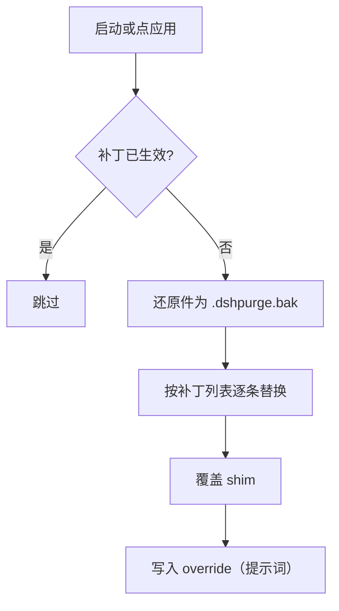
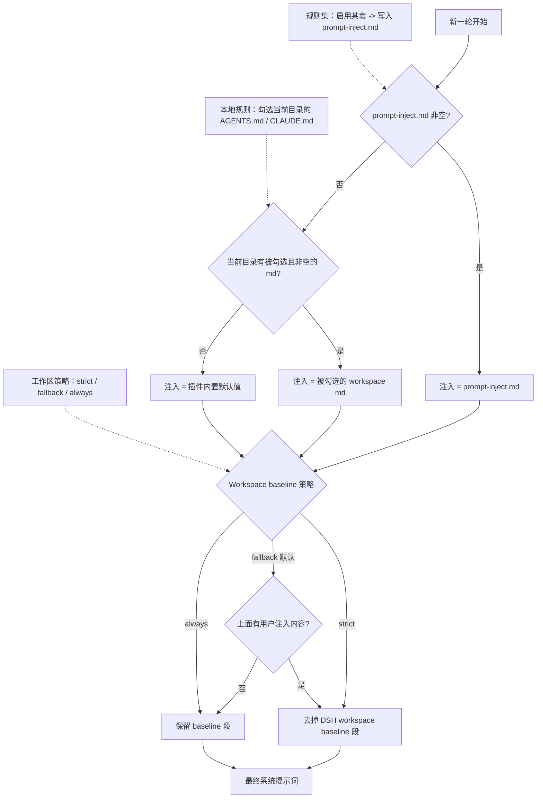

<p align="center">
  
</p>

<h1 align="center">dsh-purge</h1>

<p align="center"><strong>把 DeepSeek Harness 宿主的指令权威性拆开来看、按需重装的本机插件</strong></p>

<p align="center">
  <a href="LICENSE"></a>
  
  
  
  
</p>

<p align="center">
  <a href="README.md"><strong>中文</strong></a> · <a href="README.en.md">English</a> · <a href="docs/ROADMAP.md">路线图</a> · <a href="#给-agent-的安装手册">给 Agent 的安装手册</a>
</p>

> **这是什么。** 一个装在你本机官方 [DeepSeek Harness](https://www.deepseek.com/harness/) 上的插件。它把宿主在运行时加在你和模型之间的东西——系统提示词、审批门、沙箱策略、工具回执、会话改写的措辞——逐条列出来，允许你在**自己的安装**里逐条改掉、跳过或还原。共 86 个补丁，全部可逆。
>
> **这是什么仓库。** `Water-Run/dsh-purge`，[YuJunZhiXue/dsh-purge](https://github.com/YuJunZhiXue/dsh-purge) 的个人派生副本，单分支 `master`，当前内容 = 上游 1.1.71 + fork 增量（限制总闸、名单语法、0.2.1 适配），未单独发版。见[与上游的差异](#与上游的差异)。**许可与署名沿用上游，一字未松**，见[许可与署名](#许可与署名)。

---

## 目录

- [它到底改什么](#它到底改什么)
- [兼容矩阵](#兼容矩阵)
- [安装](#安装)
  - [两步装完](#两步装完)
  - [三步生效](#三步生效)
  - [验收](#验收)
  - [手动安装](#手动安装)
  - [卸载](#卸载)
- [给 Agent 的安装手册](#给-agent-的安装手册)
  - [为什么单开一节](#为什么单开一节)
  - [可粘贴的安装契约](#可粘贴的安装契约)
  - [MiniMax Code](#minimax-code)
  - [其它 Agent](#其它-agent)
- [使用](#使用)
- [限制总闸 unlock](#限制总闸-unlock)
- [自己的服务器名单](#自己的服务器名单)
- [工作原理](#工作原理)
- [运行时文件](#运行时文件)
- [排错](#排错)
- [与上游的差异](#与上游的差异)
- [路线图](#路线图)
- [许可与署名](#许可与署名)
- [使用边界](#使用边界)

---

## 它到底改什么

Harness 不是把问题直接交给模型。它会在运行时按层改东西。只看「模型答不答」，会把宿主拦截误判成模型拒绝——这个插件的存在，就是为了把这两层分开，并且让第二层可控。

| 层 | 举例（补丁编号） | 你看到的差别 |
| --- | --- | --- |
| **提示词** | 身份前缀、workspace 段、审批措辞、极简/PTC 预设的拦截句（#1–#5、#25、#26、#53、#54、#61、#63、#70、#73、#76） | 系统提示词里不再有宿主自行塞入的身份与禁令句 |
| **代码** | 审批默认值、沙箱判定、文件围栏、升级授权、工具上限、子代理深度（#6–#24、#35、#51、#52、#92） | 本机上的默认策略按你的选择走，而不是每次重新问一遍 |
| **工具** | shell / 网络 / 删除移动的拒绝文案与 schema（#29–#33、#48、#60、#64、#65） | 工具回执不再夹带「这是不允许的」式说教 |
| **兼容** | 0.1.5、0.2.0、0.2.1 的接线差异（#40、#42、#47、#49、#57、#90、#91） | 升级宿主后补丁仍然命中，而不是集体 pending |
| **shim / 运行时** | `dsh.cmd` / `dsh.ps1` 注入、Windows 命令闪窗、apply 标记（#78、#82、#85–#89） | 从哪个入口启动都带同一套配置，升级盖掉 `node_modules` 后自动补回 |

侧栏两页：**清洗**（补丁、提示词、规则集、Skill、自己的服务器）和**演练台**（授权后的资产、技能、环境页）。补丁按组展开，进度只计真正命中的项。

每个目标文件在改动前备份为 `<文件名>.dshpurge.bak`。重复应用是幂等的，还原后与原件逐字节一致。

---

## 兼容矩阵

| 宿主 | 状态 | 用哪一版 |
| --- | --- | --- |
| 官方 `dsh web`，dsh **0.2.0-rc.2 / 0.2.1-rc.2** | ✅ 本仓库 `master` | 本页命令 |
| 官方桌面 EXE，dsh **0.2.0-rc.2 / 0.2.1-rc.2** | ✅ 本仓库 `master`，profile `desktop` | 本页命令 |
| dsh **0.1.7**（含 rc.1 / rc.2） | ⚠️ 用上游 1.1.39 及更早 | 见[上游 Releases](https://github.com/YuJunZhiXue/dsh-purge/releases) |
| 社区桌面端 | ❌ 不维护 | — |

- Web 与桌面端是**两份 profile**：`web` 和 `desktop`。包不会互相串门，各自装、各自点「应用」。
- 对不上的补丁显示 `pending` / `skipped`，不会乱改文件。这次应用仍算完成。
- `node >= 18`（见 `package.json` 的 `engines`）。npm 上没有 `dsh-purge` 这个包，`pnpm add dsh-purge` 必然 404。

---

## 安装

### 两步装完

```sh
# Web（官方 dsh web）
dsh plugin --profile web add https://github.com/Water-Run/dsh-purge/archive/refs/heads/master.tar.gz

# 官方桌面 EXE
dsh plugin --profile desktop add https://github.com/Water-Run/dsh-purge/archive/refs/heads/master.tar.gz
```

只装你在用的那个宿主就行，两个都用就两条都跑。**当前目录已经是本仓库**时，把归档地址换成 `.`：

```sh
dsh plugin --profile web add .
```

`dsh` 不在 PATH 时走[手动安装](#手动安装)。

### 三步生效

只把包装进 profile，**还不会**改 `@deepseek-ai`。少一步就是「装了但没生效」——这是最高频的误判。

1. **完全退出并重开**刚装的那个宿主：Web 关掉 `dsh web` 再起；桌面端退出托盘进程再开 EXE。
2. 点会话标题旁的 **dsh-purge** → **清洗** → **「应用」**。宿主的设置页里没有这个入口。
3. 「应用」成功后会自动重启一次，把补丁带进当前进程。**没打完不重启**，这是设计如此。

Web 的按钮只动 Web，桌面端的按钮只动桌面端。不要在 A 宿主里点 B 宿主的应用。

### 验收

| 检查 | 期望 |
| --- | --- |
| 会话标题旁 | 出现 **dsh-purge**，清洗页能点「应用」 |
| 聊天里 `/purge status` | 打出 `DSH_HOME` 与补丁清单，路径是你正在用的那一份 |
| 终端 `dsh-purge --status` | 同上，附 `shim` 目录与备份状态 |
| 可选依赖缺失（例如梁神） | 显示跳过，不挡住应用完成 |

`/purge status` 的输出里还有一行**限制闸**，告诉你当前是解锁还是恢复官方门禁。

### 手动安装

`dsh` 不在 PATH、或 `dsh plugin add` 报错时用这条。**只改你正在用的那个 profile**，另一个别动，原有依赖和 bundle 全部保留。

<details>
<summary><strong>五步手动安装</strong></summary>

**1. 找到真正在用的 `$DSH_HOME`。** 认目录：名字是 `.dsh`（官方 EXE 偶见 `dsh-home`），里面有 `profiles/`，且至少有一个 `profiles/<名>/package.json`。按顺序找：`DSH_HOME` 环境变量 → 启动器旁的 `.dsh` → `%USERPROFILE%\.dsh` / `~/.dsh` → `%APPDATA%` 或 `%LOCALAPPDATA%\DeepSeek Harness\dsh-home`。

确认 profile 名对得上：`profiles/web/package.json` 的 `"name"` 是 `dsh-profile-web`，桌面是 `dsh-profile-desktop`。本机常有两三份 `.dsh`，用你**实际启动**的那一份。

```powershell
$cands = @()
if ($env:DSH_HOME) { $cands += $env:DSH_HOME }
$cands += "$env:USERPROFILE\.dsh"
$dsh = Get-Command dsh -ErrorAction SilentlyContinue
if ($dsh) {
  $dir = Split-Path $dsh.Source
  $cands += @((Join-Path $dir ".dsh"), (Join-Path (Split-Path $dir) ".dsh"), (Join-Path (Split-Path (Split-Path $dir)) ".dsh"))
}
$cands += @("$env:APPDATA\DeepSeek Harness\dsh-home", "$env:LOCALAPPDATA\DeepSeek Harness\dsh-home")
$cands | Select-Object -Unique | Where-Object { $_ -and (Test-Path (Join-Path $_ "profiles")) }
```

**2. 把插件放到位：`$DSH_HOME/plugins/dsh-purge`。** 目录名必须是 `dsh-purge`，其 `package.json` 的 `"name"` 也必须是 `dsh-purge`。

```sh
git clone https://github.com/Water-Run/dsh-purge.git "$DSH_HOME/plugins/dsh-purge"
```

没有 git 就下 [master.tar.gz](https://github.com/Water-Run/dsh-purge/archive/refs/heads/master.tar.gz)，解压后把 `dsh-purge-master` 改名成 `dsh-purge`，整个文件夹放进 `plugins`。**已有本仓库副本就整夹复制**，不要只挑几个 `.js`。

**3. 只追加两处到对应 profile 的 `package.json`（先备份）。**

1. `dependencies` 里加 `"dsh-purge": "file:../../plugins/dsh-purge"`
2. `dsh.profile.bundles` **末尾**加 `"dsh-purge"`（已存在就不要再加）

```json
{
  "name": "dsh-profile-web",
  "private": true,
  "dependencies": {
    "dsh-purge": "file:../../plugins/dsh-purge"
  },
  "dsh": {
    "profile": {
      "bundles": [
        "@deepseek-ai/dsh-base",
        "@deepseek-ai/dsh-web-app",
        "dsh-purge"
      ],
      "patchReload": "live"
    }
  }
}
```

JSON 必须合法（新项前有逗号，末项后没有多余逗号）。`file:../../plugins/dsh-purge` 不要改成绝对路径；`patchReload`、其它插件、版本号都别碰；`"dsh-purge"` 不要写两次。桌面端没有 `dsh-web-app`，别硬加。

**4. 在刚改的那个 profile 目录里装依赖**（不要在本仓库根、也不要在 `$DSH_HOME` 根）：

```sh
cd "$DSH_HOME/profiles/web"   # 或 profiles/desktop
pnpm install
```

成功标志：出现 `profiles/<web|desktop>/node_modules/dsh-purge/package.json`。找不到 `pnpm` 就用官方 `dsh` 自带的 Node / pnpm；报 `Could not resolve` 检查 `file:` 路径；JSON 解析失败就修逗号或还原备份。

**5. 完全退出宿主 → 重开 → 点「应用」**，与[三步生效](#三步生效)一致。按钮没出现，八成是改错了另一份 `.dsh`，回第 1 步核对。

</details>

### 卸载

面板：**dsh-purge** → 清洗 → **卸载**。弹窗确认后先还原已应用的补丁（回到原版 Harness），再重启当前宿主。

```sh
dsh-purge --uninstall    # 命令行等价
# 聊天里：/purge uninstall
```

`prompt-inject.md` 是用户文件，卸载与还原都会保留。用户 Skill 同样保留。

插件配置在 [cordis.patch.yml](cordis.patch.yml)：

```yaml
- insert:
    - id: dsh-purge
      name: 'dsh-purge'
      config:
        enabled: true
        autoApplyOnStart: false
        autoUpdateOnStart: false
        autoRevertOnMissing: false
        injectOnce: false
        stripMnemon: true
        verbose: false
        postPrompt: ""
        postPromptOrder: 5100
        autoRetry: true
        retryMax: 3
        autoContinue: false
        continueMax: 3
        continueText: "继续"
        capabilityProtocol: true
        hooksDenyBypass: true
```

`autoApplyOnStart` 默认 **false**：启动时只检查、不写盘。要在启动时自动补回，把它改成 `true`。

---

## 给 Agent 的安装手册

### 为什么单开一节

Agent 装这个插件最常见的三种翻车方式，都不是命令写错：

1. **全盘搜索** `DeepSeek Harness`，然后在 `resources/app` 里找到一份旧 `node_modules`，改的是没在用的那份。
2. 装完顺手点「应用」或重启宿主，把用户还没准备好的改动推进去。
3. 看见包名就去 `pnpm add dsh-purge`，然后拿到 404 并开始"自行修复"。

所以下面这段是**契约**，不是建议。粘贴给 Agent 时，连 HTML 注释标记一起给，方便它按块识别边界。

### 可粘贴的安装契约

```text
<!-- dsh-purge:AGENT-INSTALL:START -->

任务：把 dsh-purge 插件装进本机 DeepSeek Harness 的指定 profile。只安装，不应用。

参数：
  REPO_DIR    = 本仓库根目录；若当前工作目录就是本仓库，命令里的 <SRC> 用 .
  TARBALL_URL = https://github.com/Water-Run/dsh-purge/archive/refs/heads/master.tar.gz
  PROFILE     = web 或 desktop（用户点名哪个就装哪个；没点名就两个都装，缺哪个跳过哪个）
  <SRC>       = REPO_DIR 或 TARBALL_URL

允许：
  - 读本 README 与 package.json
  - 执行 dsh 命令、检查 $DSH_HOME/profiles/<PROFILE>/package.json
禁止：
  - 全盘搜索、读或写本仓库以外的文件
  - 改 @deepseek-ai 下的任何包、改 profile 的其它字段
  - 点「应用」、改配置、重启宿主
  - pnpm add dsh-purge（npm 上没有这个包）

步骤：
 1. 确认 dsh 可用：dsh --version。不可用就报告「dsh 不在 PATH」并停止，不要自己找替代。
 2. 安装：
      dsh plugin --profile <PROFILE> add <SRC>
    每个 profile 一条，失败的那条记下错误原文，继续下一条。
 3. 校验（两条都要过）：
      <DSH_HOME>/profiles/<PROFILE>/node_modules/dsh-purge/package.json 存在
      该文件里 "name" 等于 "dsh-purge"
 4. 停止。不要应用、不要重启。

回报格式（逐行，别写散文）：
  dsh        : <版本> (<路径>)
  DSH_HOME   : <路径>
  web        : 已装 | 已存在 | 跳过(profile 不存在) | 失败:<错误原文>
  desktop    : 同上
  下一步     : 完全退出宿主 -> 重开 -> 会话标题旁 dsh-purge -> 清洗 -> 应用
<!-- dsh-purge:AGENT-INSTALL:END -->
```

装完必须由**人**完成的只有一行：重启宿主，然后在清洗页点「应用」。这一步交给 Agent 做，出问题时你会找不到是哪一层动的手。

### MiniMax Code

MiniMax Code 有桌面端、网页端和 CLI，也支持把本地项目目录作为工作区（[官方文档](https://platform.minimax.io/docs/m-plan/minimax-code)）。三种用法都可以：

**桌面端 / 网页端**

1. 打开 MiniMax Code，把**本仓库目录**作为项目加进来（桌面端选本地文件夹）。
2. 新开一个任务，贴入上面[安装契约](#可粘贴的安装契约)整段。
3. 它执行完会按回报格式列出结果。若它擅自尝试「应用」或重启，回一句：`只做安装，不要应用、不要重启，按契约第 4 步停止`。

**CLI**

在仓库根目录启动，让它读 README 再执行：

```text
读本目录的 README.md，找到 “AGENT-INSTALL” 块，按里面的契约把 dsh-purge 装进 web 和 desktop 两个 profile。
只安装。不要应用，不要重启。执行完按块里的回报格式输出。
```

**给 MiniMax Code 的三条提醒**

- 它倾向先做一次目录探查。直接告诉它 `不要全盘搜索，仓库根目录就是 SRC`，能省掉几分钟和一次改错文件的机会。
- Windows 上它的 shell 一般是 PowerShell，`dsh` 会解析到 `dsh.ps1`，命令照抄即可，不用改扩展名。
- 它可能把「装好」理解成「可用」。这里不是：**装好 = 包在 profile 里；可用 = 人重启宿主并在清洗里点过应用**。

### 其它 Agent

同一段契约对下面这些都成立，差别只在粘贴位置：

| Agent | 怎么给 |
| --- | --- |
| Claude Code / Codex CLI | 在仓库根目录开会话，直接粘贴契约块；它们会把命令跑在 shell 里 |
| Cursor | 打开本仓库，Agent 面板粘贴契约块；确认它用的是终端而不是编辑器内的假执行 |
| 任意本地 Agent | 只要能执行 shell 且能读 `package.json`，就走同一段契约 |

需要更强的约束时，在 Agent 的规则文件里加一行：`安装 dsh-purge 只允许执行 README 的 AGENT-INSTALL 契约，不得应用补丁、不得重启宿主。`

---

## 使用

### 面板

会话标题旁点 **dsh-purge**，右侧栏两页。白 / 墨主题可切。

| 区域 | 用途 |
| --- | --- |
| **清洗** | 补丁分组状态，应用 / 还原 / 卸载；编辑 `prompt-inject.md`；规则集；Skill 导入；自己的服务器名单 |
| **演练台** | 资产、技能、环境三页。本 fork 默认不弹授权窗，直接进（见[限制总闸](#限制总闸-unlock)） |
| **提示词** | 编辑 `$DSH_HOME/prompt-inject.md`，作为会话覆盖段 |
| **规则集** | 多套 `AGENTS.md` / `CLAUDE.md`，启用即写入 `$DSH_HOME` |
| **Skill** | 导入压缩包或文件夹到 `$DSH_HOME/skills/<id>/SKILL.md`；命中与加载由 DSH 自己负责 |

<p align="center">
  
  
</p>

更多截图在 `docs/preview/`（补丁、规则集、自己的服务器、授权窗）。第一次应用前建议先看一眼清洗页的分组，知道自己在打开哪一层。

### 命令

```sh
# CLI
dsh-purge --status       # 状态：DSH_HOME、目标文件、86 个补丁逐条状态、shim、备份
dsh-purge --apply        # 应用：提示词 + 代码 + shim + override
dsh-purge --revert       # 还原：用 .dshpurge.bak 覆盖回去
dsh-purge --uninstall    # 卸载：先还原，再清插件
dsh-purge --edit         # 编辑注入文件
```

```text
# 聊天
/purge status | apply | revert | uninstall | edit | help
/rules  list | use <id> | create <id> [别名] [目标] | delete <id> | reset | help
/skills list | import <路径> | create <id> [说明] | delete <id> | help
/rewind once | round
```

```text
# 模型工具（Agent 可直接调）
purge_status    purge_apply    purge_revert
```

### 回退

输入框旁的「回退一次」「回退上一轮」走官方 `session.fork({ atSeq })`：撤回已发出的那一轮，新会话接上之前上下文，旧会话归档，那句话回到输入框，**再发送会重新注入**。聊天里 `/rewind` 等价。

### 响应速度

DSH 按顺序执行同一批 Bash 调用。旧版插件把默认前台等待从 60 秒抬到过 10 分钟，一条慢命令会拖住后面所有调用。补丁 #21 现在把**带插件标记**的旧值恢复成官方 60 秒；无标记的自定义值保留。

想更快拿到工具结果，在 `$DSH_HOME/profiles/web/cordis.patch.yml`（通常 `~/.dsh/profiles/web/cordis.patch.yml`）加：

```yaml
- id: bash-sandbox
  config:
    timeoutMs: 10000
```

已有同 id 条目就改原条目，别重复加。这个 profile 覆盖层在内置配置之后加载，后续应用插件会保留它。配合 jobs 服务的 `promoteOnTimeout: true`，未完成的命令 10 秒后转后台并返回 job id，用 `job_output` 取结果、`job_kill` 停。**它只缩短前台等待，不会让命令本身跑得更快。**

---

## 限制总闸 unlock

本 fork 把插件自己那几道门改成**默认放行**。开关只有一个：`$DSH_HOME/dsh-purge/unlock.json`。

```json
{ "gates": true }
```

| 取值 | 行为 |
| --- | --- |
| `false` / 文件不存在（默认） | 插件门禁全部放行 |
| `true` | 恢复官方门禁：区域与银行拦截、演练台授权窗、首次声明窗、面板跨域校验、名单只收单个 IP |
| 环境变量 `DSH_PURGE_GATES=1` | 优先级最高，临时恢复门禁 |

放行项：区域/银行拦截钩子不挂；`own-servers` 接受 CIDR、区间、通配；演练台 `GET /dsh-purge/drill-grant` 直接落授权；欢迎声明窗不再弹；`/dsh-purge/*` 的同源与 `Sec-Fetch-Site` 校验放行。

改 `lib/` 要重启 dsh；改 `client.js` 刷新页面即可。重启后可查可改：

```sh
curl -s  http://127.0.0.1:<port>/dsh-purge/unlock
curl -s -X POST http://127.0.0.1:<port>/dsh-purge/unlock \
     -H 'content-type: application/json' -d '{"gates":true}'
```

**它只管插件自己的拦截**，不碰 DSH 官方的沙箱、审批、工具策略——那些归[清洗](#它到底改什么)的补丁管。细节与改动位置见 [docs/unlock.md](docs/unlock.md)。

---

## 自己的服务器名单

这张名单服务于**区域拦截**那一层。上游的门禁会拦掉中国大陆、香港、澳门地址，只有事先登记的那台例外——对话里说「这是我的服务器」不算，密钥和密码也不算。

**本 fork 默认把这层门禁关掉了**（[限制总闸](#限制总闸-unlock)），关着的时候名单不参与判定；写 `{"gates": true}` 恢复门禁后，名单立刻按下面的语法生效。名单本身的写法：

1. **dsh-purge** → **清洗** → 滚过**提示词**，下面是**自己的服务器**。
2. 每行一台，写法任选：`203.0.113.10`、`10.0.0.0/8`、`10.0.0.1-10.0.0.254`、`*.corp.example`、`my-vps.example.com`、`alice@my-vps.example.com`、`host:port`、`https://host/path`。一行写多台（逗号或空格分隔）会拆开逐条收。
3. 点**保存名单**，写入 `$DSH_HOME/net-scope-allow.txt`。
4. 密钥块与非主机碎词在保存时被丢弃。没进名单的这些地区地址仍然禁止。

`203.0.113.10` 与 `example.com` 只是写法示例，不是放行地址。

---

## 工作原理

应用（启动时或点「应用」）：



每一轮的注入决策。左边三项就是面板里能改的东西，虚线是它们各自驱动哪一步判定：



补丁匹配是**字面锚点**匹配，不做模糊猜测：原文对不上就是 `pending`，宁可这次少改，也不乱改。宿主升级后锚点漂移，这是维护成本的主要来源，见[路线图](docs/ROADMAP.md)第一项。

还原：`--revert` 用备份覆盖回去并删备份；没有备份时只剥掉 shim 里由本插件写入的行。

---

## 运行时文件

`bin/` 是命令行，`lib/` 是补丁与演练台，`presets/redteam/` 是红队预设，`skills/redteam/` 是随包技能，`client.js` 是侧栏。

| 路径 | 谁写的 | 说明 |
| --- | --- | --- |
| `$DSH_HOME/prompt-inject.md` | 你 | 会话覆盖段，用户文件，还原与卸载都保留 |
| `$DSH_HOME/rules/` | 面板 | 规则集 |
| `$DSH_HOME/skills/` | 面板 / 导入 | 官方 Skill 目录 |
| `$DSH_HOME/net-scope-allow.txt` | 面板 | 自己的服务器名单 |
| `$DSH_HOME/dsh-purge/unlock.json` | 你 / HTTP | 限制总闸 |
| `$DSH_HOME/redteam/` | 演练台 | SQLite 事实库与报告 |
| `<目标文件>.dshpurge.bak` | 应用时 | 还原依据，别手工删 |

`DSH_HOME` 未设时，先找启动器旁的 `.dsh`，再退回 `~/.dsh`。Web 和桌面端各用自己那一份主目录。Skill 不进注入段，也不顶替提示词。

路径探测顺序（Web）：`DSH_HOME` / `DSH_BASE` → 启动器旁的 `.dsh` → `npm prefix -g` / `npm root -g` → 嵌套 `@deepseek-ai/dsh/node_modules/@deepseek-ai` → `~/.dsh`。都找不到时提示设置 `DSH_BASE`，不动文件。

---

## 排错

| 症状 | 先查什么 |
| --- | --- |
| 会话标题旁没有 dsh-purge | profile 的 `bundles` 里有没有 `dsh-purge`；改的是不是正在用的那份 `.dsh` |
| 有按钮，应用后没变化 | 宿主没重启，或补丁全 `pending`（宿主版本对不上） |
| 补丁集体 pending | 宿主大版本变了，锚点漂移；跑 `dsh-purge --status` 看逐条状态 |
| 应用后功能异常 | `--revert` 回原版，再看是哪一组补丁引起的 |
| 桌面端点应用没反应 | Web 的包没进桌面 profile；两个 profile 要分开装 |
| `failed to import` | 主入口语法错误，`node --check lib/index.js`；上游 1.1.70 出过同类问题 |
| 改了 `lib/` 不生效 | 宿主启动时载入 `lib/`，必须重启；`client.js` 才是热更新 |
| 想局域网开面板 | DSH 的 `webServer` 拒 `0.0.0.0`，不在本插件门禁范围 |
| 应用后闪窗 | Windows 下 shim 已处理；仍闪就用 `dsh.ps1` 启动并保留终端输出 |

---

## 与上游的差异

`master` 相对上游 [YuJunZhiXue/dsh-purge](https://github.com/YuJunZhiXue/dsh-purge) 的增量：

| 项 | 内容 |
| --- | --- |
| **限制总闸** | 新增 `lib/unlock.js`，插件门禁默认放行，`unlock.json` / `DSH_PURGE_GATES=1` 一键回官方行为（[docs/unlock.md](docs/unlock.md)） |
| **名单语法** | `own-servers` 接受 CIDR、区间、通配、`user@host`、URL；`compileAllowMatchers()` 让网段真正参与匹配 |
| **0.2.1 适配** | #57 兼容 `instructionRole` 改名；`cwd` 改模板变量 `{{cwd}}`；五个兼容补丁落到 profile 副本（[docs/compat-0.2.1.md](docs/compat-0.2.1.md)） |
| **面板跨域** | 解锁模式下 `/dsh-purge/*` 换 IP、反代、跨端口可用 |
| **单分支** | 只有 `master`；`feat/unlock-gates` 已并入并删除 |
| **文档** | README 重写；路线图独立成 [docs/ROADMAP.md](docs/ROADMAP.md) |

上游的征集、广告位、发版公告属于上游作者的业务安排，本仓库不复制这些内容；**许可与署名要求照旧继承**，见下一节。

---

## 路线图

完整的优先级、验收标准与风险评估在 **[docs/ROADMAP.md](docs/ROADMAP.md)**。摘要：

1. **补丁锚点自愈 + `purge_doctor`**：86 个补丁全靠字面匹配，宿主一升级就集体 pending。给出「哪一条挂了、为什么、候选锚点是什么」。
2. **测试与 CI**：现在只有 `node --check`。给纯函数补 `node:test`，CI 跑语法 + import + pack 白名单快照。
3. **fork 自己的发版链**：`.github/workflows/release.yml` 的 `if:` 锁在上游仓库，本 fork 永远不发版；要么改门，要么明确「本 fork 只跟不发布」。
4. **门禁粒度**：`unlock.json` 从总闸拆成 per-gate（区域 / 演练台 / 跨域 / 声明窗 / 名单），并记审计日志。
5. **版本语义**：`package.json` 停在 1.1.71，代码已超出。定 `+fork.N` 或独立 minor，别让「同版本不同内容」。

---

## 许可与署名

**本仓库不是开源项目。** 正本是 [LICENSE](LICENSE)，本 fork 原样继承，未做任何放宽。

| 你要做的事 | 怎么走 |
| --- | --- |
| 把已拿到的包装在自己电脑上用 | 可以，见 [LICENSE](LICENSE) |
| 卖插件、卖课、卖 token、白标、给别人当产品 | 先找上游作者买授权，见 [LICENSE-COMMERCIAL.md](LICENSE-COMMERCIAL.md) |
| 改名、去署名、冒充作者或「官方」 | 禁止 |
| 把源码或核心实现再公开到别的仓库、网盘、频道 | 禁止 |
| 换证前以 MIT 发出的旧 tag / tarball | 仍按当时那份 MIT，已发出的收不回 |

**署名要求（强制）**：使用本项目的名称、思路、代码或提示词，必须写明作者与来源仓库 [YuJunZhiXue/dsh-purge](https://github.com/YuJunZhiXue/dsh-purge)；本 fork 另标 `Water-Run/dsh-purge`。不署名、藏来源、改头换面当自己的，上游作者与本 fork 都会追究。

**第三方归属**：演练台部分源自 [`dsh-redteam-mode`](https://github.com/Jueze-2019/dsh-redteam-mode)，MIT，Copyright (c) 2026 Jueze-2019。MIT 文本与双用途声明随包保留在 [docs/redteam-upstream-LICENSE](docs/redteam-upstream-LICENSE) 与 [docs/redteam-upstream-DISCLOSURE](docs/redteam-upstream-DISCLOSURE)，**不得删除**。本仓库其余部分不适用 MIT。

**闭源与发版安排以上游公告为准**：上游自 2026-10-27 起不再在 GitHub 发新版，新包只走其 Telegram 频道。本仓库是个人派生副本，不承诺对外发布，也不对外授权。

---

## 使用边界

- 只作用于**你本机已安装的官方 Harness**：`@deepseek-ai` 包与本机 profile / `$DSH_HOME`。不扫描、不探测、不向任何第三方系统发包。
- 评测对象限于：你自己的本机、离线靶标、已获书面授权的演练环境。这是使用建议，不是插件的拦截——插件不会替你判断目标。
- 上游自带区域 / 银行拦截（中国大陆、香港、澳门网段等）。**本 fork 默认把它关掉**，需要时在 `unlock.json` 里写 `{"gates": true}` 或设 `DSH_PURGE_GATES=1` 恢复。关掉之后，对什么目标动手由你自己判断、自己负责。
- 使用者对自己的下载、部署、运行、修改与传播行为，以及由此产生的全部后果独立承担责任。作者按现状提供，不作保证。
- 本项目与 DeepSeek 官方无隶属、无合作、无背书。文中「官方」只指评测对象是你本机装的官方软件包。

---

<p align="center"><sub>感谢 <a href="https://linux.do">LINUX DO</a> 社区。补丁列表与逐条改动位置见 <code>dsh-purge --status</code>。</sub></p>
