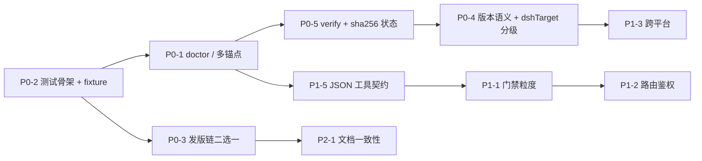

# dsh-purge 路线图

本文件是**可继续开发优化的内容**，按优先级排列。每条都写清：现状证据 → 做法 → 验收标准 → 大致工作量。不写"调研一下""持续优化"这种没有验收口的条目。

标注：**P0** = 不做会持续产生错误维护成本；**P1** = 能力缺口，做了明显好用；**P2** = 体验与文档；**不做** = 已明确放弃。

当前基线：`master`（单分支）、86 个补丁、`lib/` 约 37k 行、`client.js` 510 KB、无测试目录、无 CI 检查。

---

## P0 · 可靠性与可维护性

### P0-1 补丁锚点自愈 + `purge_doctor`

**现状**：86 个补丁全靠字面锚点匹配宿主文件。宿主从 0.2.0 升到 0.2.1 时 `#57` 的 `const role = ...` 直接命不中（`docs/compat-0.2.1.md` 记录了这一例）。一次小版本升级就可能让整组补丁变 `pending`，而 `--status` 只告诉你"没命中"，不告诉你"为什么、差在哪、候选锚点是什么"。

**做法**：

1. 每个补丁补两个字段：`anchors: [精确串, ...]`（多候选，按序尝试）与 `probe`（命中失败时取宿主文件里 ±3 行上下文）。
2. 新增 `dsh-purge --doctor [--json]`：逐条输出 `{ id, status, anchor_tried, anchor_hit, context_snippet, suggest }`。
3. 失败分类收敛成四类：`anchor_miss`（内容变了）、`file_missing`（路径漂移）、`already`（已打）、`conflict`（被别的补丁改过）。
4. `purge_status` 的模型工具里加同一份 JSON，Agent 可以直接读，不用解析人类文本。

**验收**：拿 0.2.0-rc.2 与 0.2.1-rc.2 两份宿主跑 `--doctor --json`，`#57` 在两份上都是 `applied` 或 `anchor_hit=false + 正确 suggest`；不再出现"整组变 pending 且无解释"。

**工作量**：中等（改 `lib/core.js` 的补丁表结构与 `renderStatus`，加一个 CLI 分支）。

---

### P0-2 测试与 CI

**现状**：仓库没有任何测试目录，验证手段是 `node --check` 加手工自测（见 `docs/unlock.md` 的"自测"一节）。`bin/dsh-purge.js` 里 `--apply` 会直接写 `@deepseek-ai` 下的文件——这是最不该靠手点的路径。

**做法**：

1. `node:test` + `node --test`，不引第三方框架。首批覆盖**纯函数**，这些已经完全不依赖宿主：
   - `net-scope.js`：`entryHost`（CIDR / 区间 / 通配 / `user@host` / `host:port` / URL / IPv6 带括号）、`normalizeAllowText`（混排、注释、密钥块丢弃）、`permittedHost` 与 `compileAllowMatchers` 的匹配一致性。
   - `unlock.js`：`gatesEnforced` 的三种来源优先级（env > 文件 > 默认）、文件缺失、坏 JSON、缓存 TTL。
   - `zip-extract.js`：`../`、绝对路径、盘符路径、空段必须抛 `zip 路径不合法`。
   - `core.js` 的 `summarizeApplyReport` 与 `patchStatus` 的分类（给固定 fixture 目录）。
   - 正则类：`isCwdOnlyText`、`CWD_ONLY_SUFFIX` 的边界。
2. 新增 `.github/workflows/ci.yml`：`node --check` 全量 → `import('./lib/index.js')` → `node --test` → `npm pack --dry-run` 的白名单断言。
3. 白名单断言要写成测试：打包产物里**不得**出现 `lib/default-prompt-inject.md`、`default-prompt-inject.md`、`*.bak`、`docs/agents/`。
4. 应用/还原的集成测试放在临时目录里跑：拷一份假 `@deepseek-ai` fixture → apply → 断言每处改动 → revert → 断言与原件逐字节相同。

**验收**：`pnpm test` 本地全绿；CI 在 PR 上跑并卡住语法错误（上游 1.1.70 就因为主入口语法错误发出过 `failed to import`）；集成测试能在不碰真实安装的情况下证明 apply/revert 幂等。

**工作量**：中等偏大（先把 fixture 造出来，后面每条补丁都能顺手加用例）。

---

### P0-3 fork 自己的发版链，或明确"只跟不发布"

**现状**：`.github/workflows/release.yml` 第一行就是 `if: github.repository == 'YuJunZhiXue/dsh-purge'`。本 fork（`Water-Run/dsh-purge`）上这个 job 永远 skip——**Push 到 master 什么都不会发生**，但 README 的安装命令又指向 `master.tar.gz`，两者不矛盾却容易误以为"发版了"。

**二选一，必须选**：

- **A. 要发版**：把 `if:` 改成 `github.repository == 'Water-Run/dsh-purge'`，`release-notes.md` 首行版本校验保持不变，另加 `--prerelease` 判定（现有逻辑对 `*beta*|*alpha*|*rc*` 生效，`-fork.N` 需要单独加分支）。
- **B. 不发布**：删掉这个 workflow（或保留但改名 `upstream-release.yml` 并注明"本 fork 不执行"），README 明确写"本 fork 不产出 Release，安装只认 `master` 归档"。

**验收**：推到 master 后 GitHub Actions 页面有明确结果（要么出 Release，要么根本不存在这个 job），没有"看起来成功其实被 skip"的中间态。

**工作量**：小。

---

### P0-4 版本语义

**现状**：`package.json` 是 `1.1.71`，但代码里已经有 unlock 总闸与 0.2.1 适配，内容超出 1.1.71 所代表的那个包。`installed-rev` 会写 `apply:x.y.z` 这类标记（`lib/index.js:869`），同版本不同内容会让"是否已应用"的判断失去意义。

**做法**：采用 `1.2.0-fork.1` 形态（或 `1.1.72+fork.1`）。规则：

1. 上游同步时保留上游版本号在前，fork 增量用 `-fork.N` 递增。
2. `installed-rev` 的键里带上 fork 段，避免与上游同版本混在一起。
3. `dshTarget` 从单值 `"0.2.0-rc.2"` 改成分级：`{ supported: [">=0.2.0-rc.2 <0.3.0"], tested: ["0.2.0-rc.2", "0.2.1-rc.2"] }`，启动时读宿主版本并对不上时给提示而不是静默 pending。

**验收**：升级插件后 `/purge status` 能看出"旧标记来自哪个版本"；宿主版本超出 `supported` 时首次应用有明确提示。

**工作量**：小（版本与字段），中（宿主版本探测与提示）。

---

### P0-5 应用前快照 / 应用后校验 / 还原后零差异

**现状**：还原靠 `<文件>.dshpurge.bak`。备份存在就还原，不存在就只剥 shim 行。缺一个"我到底改了多少、还原是否干净"的可验证结论。

**做法**：

1. `dsh-purge --verify`：对每个已应用补丁报告 `{ 文件, 期望, 实际, 是否等价 }`。
2. 应用前把 `{ 文件: sha256 }` 写进 `$DSH_HOME/dsh-purge/state.json`；还原后逐项比对 sha256，不等则报 `residual` 并列出差异位置。
3. `--uninstall` 结束前跑同一校验，`residual` 非空就不删插件文件（现在 `uninstall.js` 已有"还原失败则中止"的雏形，把判据换成 sha256）。

**验收**：apply → verify（全绿）→ revert → verify（`residual: []`）；人为改一个字节后 verify 能定位到文件和行。

**工作量**：中等。

---

## P1 · 能力缺口

### P1-1 门禁粒度化

**现状**：`lib/unlock.js` 是一个总闸，五个门一起开或一起关。粒度太粗——例如想保留"演练台授权窗"但放开区域拦截，现在做不到。

**做法**：`unlock.json` 支持按门配置，缺省沿用总闸：

```json
{ "gates": {
    "region": false, "drill": false, "welcome": false,
    "cors": false, "ownServers": false
} }
```

`gatesEnforced(dshHome)` 拆成 `gateEnabled(name, dshHome)`；`DSH_PURGE_GATES=1` 仍是最粗的那层覆盖。`/purge status` 逐门展示当前状态。

**验收**：单独打开 `region` 后，区域拦截生效而演练台仍免授权；五种组合各有用例。

**工作量**：小偏中。

---

### P1-2 面板路由鉴权

**现状**：解锁模式下 `allowPluginRequest()` 直接 `return true`（`lib/index.js:1705`），即 `/dsh-purge/*` 换 IP、反代、跨端口全通。`/dsh-purge/unlock` 还能 POST 改门禁状态。

**做法**：加一个可选的共享 token——`unlock.json` 里配 `{"token": "<随机串>"}`，请求需带 `x-dsh-purge-token`；未配置时维持现状（本机自用不受影响）。`dsh-purge --token` 生成并打印。

**验收**：配了 token 后无头请求 401；本机浏览器自动带上（`client.js` 从注入的运行时配置里取）；未配 token 时行为与今天一致。

**工作量**：小。

---

### P1-3 跨平台

**现状**：shim 与闪窗处理集中在 Windows（`dsh.cmd`、`dsh.ps1`、`hide-console.js`、`official-update.wscript`）。macOS / Linux 上只有 `dsh` 软链，相关分支未验证。

**做法**：

1. 加 POSIX shim（`dsh` 的可执行包装，注入同样的环境变量与参数）。
2. 把平台相关逻辑收进一个 `lib/platform/` 目录，按 `process.platform` 分派，避免每处 `if (win32)`。
3. macOS / Linux 各跑一遍 apply → status → revert，把结果记进 `docs/compat-*.md`。

**验收**：Linux 上 `dsh` 包装生效（环境变量可见），`--status` 的 shim 段落不再显示"未定位"。

**工作量**：中等。

---

### P1-4 Skill 导入的边界

**现状**：`lib/zip-extract.js` 已挡住 `../`、绝对路径、盘符路径与空段（第 22–24、93–95 行），这块做得对。缺的是**规模**限制：没有条目数、解压后总大小、单文件大小上限，也没有拒绝符号链接与设备文件。压缩炸弹能把 `$DSH_HOME` 塞满。

**做法**：`listZipEntries` 阶段就做预算检查（条目 ≤ 2000，解压总量 ≤ 200 MB，单文件 ≤ 20 MB，压缩比 > 200:1 直接拒），超限抛结构化错误给面板提示；解压后校验 UTF-8，非文本扩展名拒收。

**验收**：构造一个 10 MB 的 42.zip 型样本，导入被拒且提示具体超了哪一项；正常 skill 包导入不受影响。

**工作量**：小。

---

### P1-5 `purge_doctor` 的 Agent 契约

**现状**：Agent 能调 `purge_status` / `purge_apply` / `purge_revert`，但拿到的是给人看的中文长文本，没有稳定的结构化字段。

**做法**：三个工具都支持 `{ json: true }`，返回固定 schema（`{ ok, dsh_home, host_version, patches: [{ id, name, layer, status, reason }], gates: {...} }`）。README 的 Agent 段加一句"排错先调 `purge_status {json:true}`"。

**验收**：拿到 JSON 的 Agent 不需要正则解析；schema 在 `lib/schema.js` 里有单测。

**工作量**：小。

---

### P1-6 生成的 `client.js` 与源码的关系

**现状**：`client.js`（510 KB）是**产物**：`scripts/build-client.mjs` 把 `lib/redteam/client.js` 的 factory 片段嵌进标记之间。产物进版本库本身没问题（插件要能被直接加载），问题是现在没有"产物是否过期"的检查——改了 `lib/redteam/client.js` 忘了跑构建，仓库里就是旧 UI。

**做法**：`node scripts/build-client.mjs --check`：重新生成到内存，与磁盘上的 `client.js` 比对，不一致就非零退出。CI 与 `pnpm test` 都跑这一步。面板源码改动同时更新标记注释里的来源哈希。

**验收**：手动改 `lib/redteam/client.js` 而不构建，CI 红；构建后绿。

**工作量**：小。

---

## P2 · 体验与文档

### P2-1 双语文档一致性

**现状**：`README.md`（中文，唯一事实源）、`README.en.md`（英文）、`README.zh-CN.md`（入口）三份。中文改了英文没跟，读者会看到两套安装步骤。

**做法**：脚本比对两份 README 的**结构**——标题层级、代码块数量、命令块内容——不一致就列出差异。结构性差异允许白名单（如中文独有的排错表）。不追求逐句翻译对齐。

**验收**：`pnpm docs:check` 能指出"EN 缺 `Unlock switch` 这一节"这种具体偏差。

**工作量**：小。

---

### P2-2 排错的机器可读化

**现状**：`dsh-purge --status` 的文本不错，但排错表只存在于 README。Agent 拿到"补丁全 pending"只能靠人。

**做法**：`--status` 的每条 `pending` 附 `reason`（`anchor_miss` / `file_missing` / `host_newer`），`--doctor --json` 再给 `context_snippet`。README 排错表里每一行对应一个 `reason` 码。

**验收**：给一份 0.3 宿主，所有 `pending` 都有 reason，README 表能一一对上。

**工作量**：小（与 P0-1 合并做）。

---

### P2-3 卸载完整性

**现状**：`uninstall.js` 会还原、删注入文件、从 profile 剥掉 bundle。缺三件事：`.dshpurge.bak` 残留、`$DSH_HOME/dsh-purge/` 目录（`unlock.json`、`state.json`）、shim 里可能残留的注入行。

**做法**：卸载清单化——打印 `removed` / `kept`（用户文件）/ `residual`（异常）三段；`--uninstall --purge-data` 才删 `$DSH_HOME/dsh-purge/`，默认保留并提示路径。

**验收**：卸载后 `git status` 干净、`profiles/*/package.json` 无 `dsh-purge` 字样、`$DSH_HOME` 下只剩明确列出的保留项。

**工作量**：小。

---

### P2-4 面板可用性

**现状**：侧栏两页、白/墨主题、分组折叠。键盘可达性与窄屏未验证；`docs/preview/*.png` 是唯一视觉参照。

**做法**：Tab 顺序与 `Esc` 关闭、焦点环可见；窄于 720px 时列表改单列；补一组截图脚本（`scripts/shots.mjs`）保证 README 截图不腐烂。

**验收**：键盘能完成"打开面板 → 应用 → 关闭"；截图与当前 UI 一致。

**工作量**：小偏中。

---

### P2-5 上游同步流程

**现状**：`upstream` remote 指向 `lhg-projects/dsh-purge`，与 `origin`（`Water-Run`）同名仓库。同步靠人工看 diff，fork 增量散在 7 个提交里。

**做法**：`docs/fork-delta.md` 记录每个 fork 提交对应上游哪一段（现在 README 的"与上游的差异"表是雏形）；同步脚本 `scripts/sync-upstream.sh`：fetch → 列出 `upstream/master..master` 与 `master..upstream/master` 两侧 → 只在冲突处人工合并。保留 `upstream` remote 的价值就在这；如果确定不再跟上游，`git remote remove upstream` 让仓库真正只剩一个分支来源。

**验收**：一次上游小版本合并能在半小时内完成并留下 delta 记录。

**工作量**：小。

---

## 明确不做的

| 项 | 原因 |
| --- | --- |
| 遥测 / 使用统计 | 本机工具，没有需要外发的数据；也是许可与信任成本 |
| 自动"修好"没命中的补丁（模糊匹配后直接写） | 锚点漂移时猜测等于乱改宿主文件。只报告候选，由人决定 |
| 内置攻击载荷、扫描器 | 插件定位是宿主层可控性，不是打点套件；扫描器在 `skills/redteam/` 里是操作手册，工具由用户自己装 |
| 把补丁逻辑改成"按宿主版本预置表" | 维护 N 份宿主副本的补丁表，成本比锚点多候选更高 |
| 拆出独立 npm 包发布 | `package.json` 无 `publishConfig` 之外的发布路径，且许可禁止再分发 |

---

## 建议顺序



先做 P0-2，因为 P0-1 / P0-5 / P1-5 都需要 fixture 才能验证；发版链（P0-3）是独立决策，可以并行先定。"不做"表里的五项不必再讨论。
